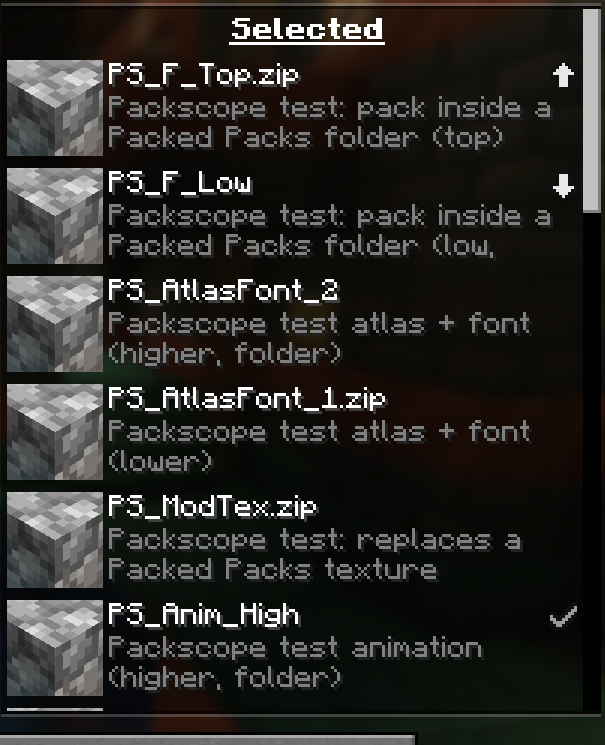
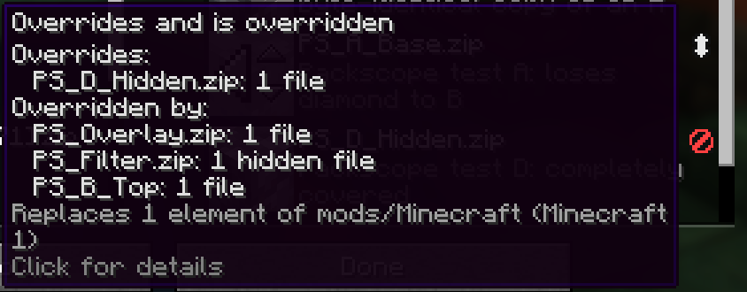
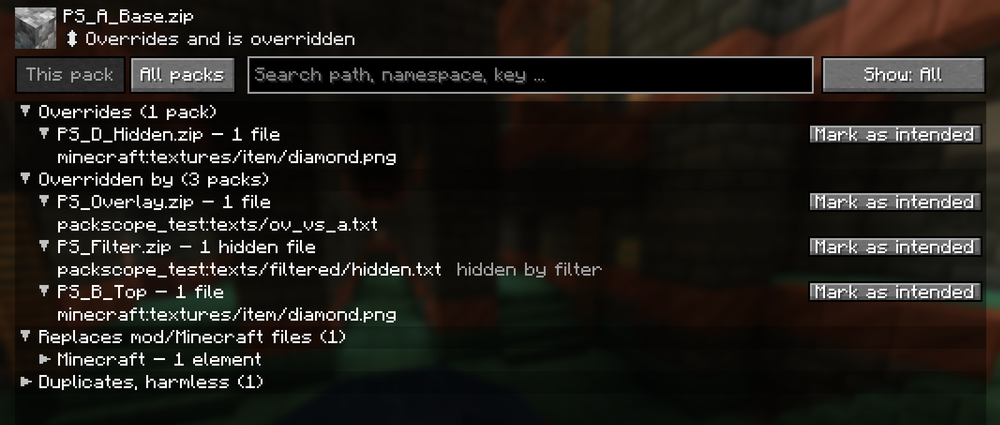
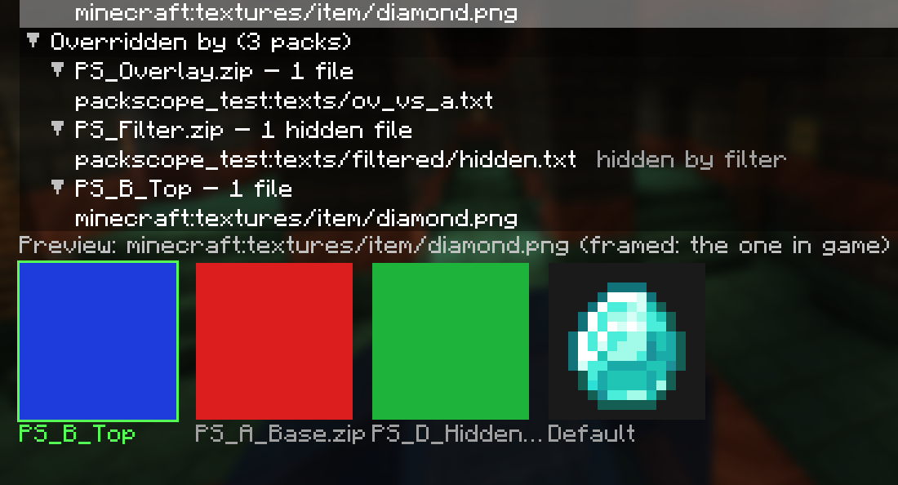
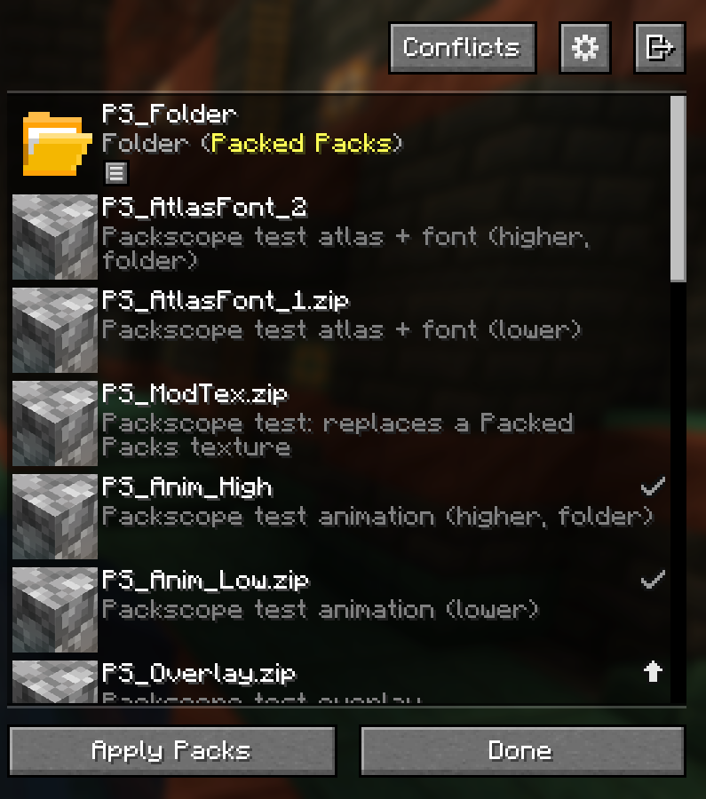
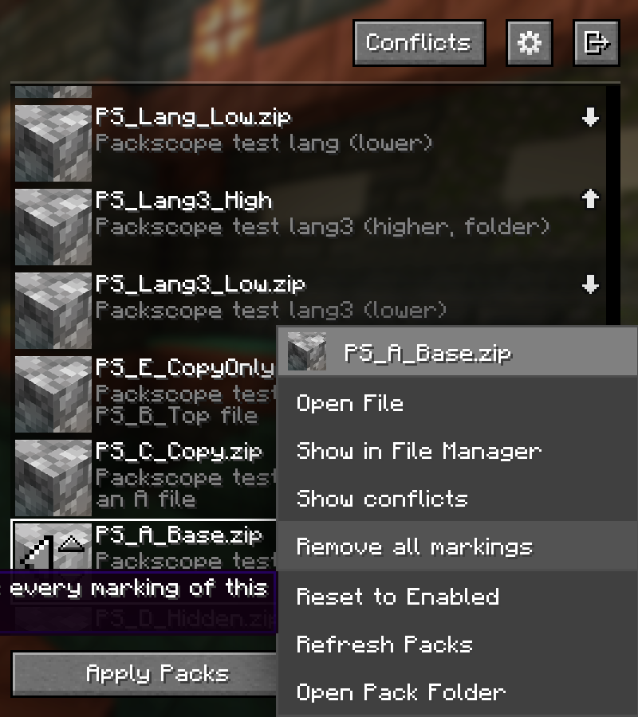

<p align="center">
  
</p>

<h1 align="center">Packscope</h1>

<p align="center">
  
  
  
</p>

🔎 **See which resource pack wins.** Packscope is a NeoForge mod for Minecraft 1.21.1 (Java 21) that shows
resource pack conflicts right in the resource pack screen, like the conflict view of **Mod Organizer 2**: every active
pack gets a small icon that tells whether it overrides other packs, is overridden, or has no effect at all any more.
A click on the icon lists every file, language entry and sound event, with a side-by-side preview of every version of
a texture.

> **Client only.** Packscope is not needed on a server. If it is installed there, it does nothing.
>
> **Read only.** Packscope never changes packs, the pack order or files of other mods. It only shows what the game
> does.

- Wiki: [github.com/Drehverschluss/Packscope/wiki](https://github.com/Drehverschluss/Packscope/wiki)
- CurseForge: coming soon
- Bug reports and suggestions: [issue tracker](https://github.com/Drehverschluss/Packscope/issues)

## Screenshots

| Resource pack screen | Tooltip |
|---|---|
|  |  |





| Packed Packs screen | Right-click menu in Packed Packs |
|---|---|
|  |  |

## How it works

When the resource pack screen opens, Packscope takes the order **shown in the screen** and evaluates it on a
background thread. Each pack is indexed straight from its zip file, folder or mod jar (paths, sizes and CRC32
checksums), then Packscope works out for every file under `assets/` which pack the game actually uses. Files the game
merges instead of replacing are rated the way the game merges them: language files per key (only the languages the
game loads), `sounds.json` per sound event, atlases and fonts never. Byte-identical copies are harmless duplicates.

The result is cached per order. Moving a pack only re-rates the existing indexes, so the icons follow every arrow
click and drag immediately, before "Done" is pressed. Opening the pack screen does not wait for anything; until the
first result is there, the icons show "Checking ...".

Overriding is counted **pairwise like in Mod Organizer 2**: a pack overrides every lower pack with the same file.
Replacing files of mods or of Minecraft itself is what resource packs are for, so it is shown as grey information,
never as a warning.

## Installation

1. Install NeoForge `21.1.265` or newer for Minecraft `1.21.1`.
2. Put `packscope-0.1.0.jar` into the `mods` folder of your **client**.
3. Open *Options → Resource Packs*.

| Mod | Version | Needed |
|---|---|---|
| NeoForge | `21.1.265` or newer | required |
| [Packed Packs](https://www.curseforge.com/minecraft/mc-mods/packed-packs) by fishstiz | `2.3` or newer (tested with `2.4.0`) | optional |

## What it does

### Status icons

Every active pack gets exactly one status; the most important one wins.

| Icon | Status | Meaning |
|---|---|---|
|  | **Completely covered** (red) | Nothing of the pack reaches the game: everything is overridden, hidden by a filter or only a copy of a higher pack |
|  | **Against marking** (yellow) | A pair you marked as intended is the wrong way round |
|  | **Replaces sounds** (yellow) | Its `sounds.json` mutes sound events of lower packs (`"replace": true`) |
|  | **Overrides and is overridden** | Both of the next two |
|  | **Overrides other packs** | Some of its files win over lower packs |
|  | **Is overridden** | Some of its files are replaced by higher packs |
|  | **Only intended conflicts** (grey) | All its conflicts are marked as intended |
|  | **Checking ...** | The order is being evaluated |

Packs without a conflict, "Default" and "Mod Resources" get no icon. The shape of each icon carries its meaning, so
they can be told apart without colour.

### Tooltip

Hovering the icon shows the status, warnings, the three biggest packs this pack overrides and is overridden by (with
files, language entries, sound events and hidden files), intended conflicts in grey and a grey line about replaced
mod and Minecraft files.

### Detail window

A left click on the icon opens the detail window; the **Conflicts** button in the header opens it for all packs.

- **This pack**: warnings, *Overrides*, *Overridden by* (one group per other pack), replaced sound events, files
  hidden by its filter, replaced mod/Minecraft files (by mod) and harmless duplicates.
- **All packs**: every pack with its status, every pack pair, completely covered packs, reversed markings and all
  markings with their state.
- **Search** by path, namespace or language key, and a **file type filter** (textures, models, language, sounds,
  other).
- **Texture preview**: every version of a texture side by side in load order, read from each pack file, the one the
  game uses framed in green.
- Language entries show the text of every pack; blockstates and `.mcmeta` files without effect are marked.
- **Done** returns to the pack screen with the same order and scroll position; nothing is applied.

### Intended conflicts

In a sorted list almost every conflict is wanted. **Mark as intended** (per pack pair, or for all pairs of a pack)
turns the icon grey; from then on only new overlaps stand out, and if a marked pair ends up the wrong way round, both
packs show **Against marking**. Markings are stored in `config/packscope-intended.json` and match a pack also after
an update that changes the version in its file name.

### Reports and commands

- **Export report** in the detail window, or the client command `/packscope report`, writes
  `packscope/reports/packscope-report.md` (readable) and `packscope-report.json` (complete) in the game folder.
- `/packscope rescan` drops the cache, reads `packscope-intended.json` again and writes the report.
- With `autoExportReport` the report is written after every resource reload.

## Configuration

Client config `config/packscope-client.toml`. It can also be edited in the game: *Mods → Packscope → Config* opens
NeoForge's config screen. Every option applies without a restart: the next time the pack screen is opened, the next
report or the next resource reload.

| Option | Default | Meaning |
|---|---|---|
| `showInVanillaScreen` | `true` | Icons, tooltips and the Conflicts button in the vanilla resource pack screen |
| `showInPackedPacks` | `true` | The same in the Packed Packs screen (only if Packed Packs is installed) |
| `ignoreIdentical` | `true` | Byte-identical files and language entries with the same text are harmless duplicates, not conflicts |
| `showModOverridesInTooltip` | `true` | The grey lines about replaced mod and Minecraft files in the tooltip |
| `ignoredPaths` | `[]` | Files that never count as a conflict (see below) |
| `previewSize` | `64` | Size of the texture preview in pixels (16 to 256) |
| `cacheEnabled` | `true` | Keep scan results in memory and the checksums of folder packs in `packscope/cache/` |
| `autoExportReport` | `false` | Write the report after every resource reload |
| `reportListModOverrides` | `false` | List every replaced mod/vanilla file in the report, not only the numbers per mod |
| `allLanguages` | `false` | Count language keys of all languages; off: only `en_us` and the selected language, the ones the game loads |
| `showIntendedSymbol` | `true` | Grey icon for packs whose conflicts are all marked as intended; off: no icon for them |

## Data-driven customization

**`config/packscope-intended.json`**: the intended markings, written by the game when you mark something and editable
by hand. A modpack can ship it so that its players see the checked conflicts as grey from the start.

```json
{
  "version": 1,
  "intended": [
    { "winner": "file/Example Textures Addon v1.2.zip", "loser": "file/Example Textures v1.4.zip", "note": "Add-on over its base pack" }
  ]
}
```

A marking matches a pack by its exact id, by its **base name** (for `file/...` ids: file name in lower case without
`.zip`, without version numbers like `v1.4` or `2.0.1`, so it survives pack updates) or by `regex:<pattern>` on the
whole id. Unknown fields are kept when Packscope writes the file.

**`ignoredPaths`** in the client config: glob patterns of files that never count. `*` matches any characters,
`?` one character; with a `:` the pattern is matched against `namespace:path`, otherwise against the path only:

```toml
ignoredPaths = ["minecraft:textures/gui/title/*", "*.txt"]
```

## Mod compatibility

- **Packed Packs** (optional): icons and tooltips in its screen, right-click items *Show conflicts*, *Mark all as
  intended* and *Remove all markings*, a Conflicts button in its header. Packs inside its folders and packs hidden in a
  profile are rated too. The integration only uses the public Packed Packs API and is loaded only when Packed Packs is
  installed. Its "Original Pack Screen" button opens the vanilla screen with Packscope as well.
- **KubeJS**: packs that KubeJS puts straight into the game's resources (its virtual packs and `kubejs/assets`) have
  no entry in the pack screen. Packscope reads the real resource stack and rates them where the game has them; they
  are shown as "(injected)".
- **Built-in packs of mods** are rated like other resource packs. Packs inside mod jars are read straight from the
  jar. Built-in packs that hold child packs show one combined icon.
- **Dynamic packs** that a mod builds while the game runs (for example from Moonlight Lib) can only be listed through
  the game; the report marks them as *approximate*.
- **Datapacks** are not supported; the datapack screen stays unchanged.

## Project layout

| Package | Content |
|---|---|
| `com.drehverschluss.packscope` | `Packscope` (common entry point, does nothing on a server) and `PackscopeClient` (client entry point) |
| `core` | Scanner, index, cache, conflict rules, intended markings, report writer. No NeoForge classes |
| `core.minecraft` | Access to the pack repository, the resource stack and pack contents (vanilla classes) |
| `gui` | Icons, tooltip, live evaluation, detail window, texture preview, Conflicts button |
| `gui.model` | Screen-independent models of tooltips and detail rows (unit tested) |
| `mixin` | Hooks into the vanilla resource pack screen and accessors |
| `compat.packedpacks` | Packed Packs integration; loaded only through its `ServiceLoader` entry |
| `neoforge` | Config, config screen, client commands, reload listener |

## Development

Requires Java 21.

- The Packed Packs API is compiled against from the fishstiz Maven (`compileOnly`); no local jars are needed to build.
- For the dev runs, every jar in `libs/test/` (git-ignored) is added via `localRuntime`. Put the Packed Packs jar there
  to test the integration.

```
./gradlew build        # jar in build/libs, runs the unit tests
./gradlew runClient    # dev client (game directory run/)
./gradlew runServer    # dev dedicated server, Packscope must load and do nothing
```

### Testing

The unit tests evaluate small test packs in `src/test/resources/testpacks/` (one per rule: whole files, language keys,
sounds with and without `replace`, filters, overlays, copies, atlases and fonts, a pack inside a folder) and check
statuses, pairs, markings and reports. By hand:

1. Put the test packs into `run/resourcepacks/`, activate them and open the resource pack screen: icons as described
   above; move a pack and watch the icons change before pressing "Done".
2. Click an icon: detail window with groups, search, filter and texture preview; "Done" returns to the same screen.
3. Mark a pair as intended, then move it the wrong way round: "Against marking" on both packs.
4. `/packscope report` in a world and read `run/packscope/reports/packscope-report.md`.
5. With Packed Packs in `libs/test/`: icons, right-click items and the Conflicts button in its screen; without it the
   client still starts and the vanilla screen works.

## License and credits

MIT, see [LICENSE](LICENSE) (also included in the jar). Details in [CREDITS.md](CREDITS.md).

- The idea comes from the conflict view of **Mod Organizer 2** (idea only, no code used).
- The Packed Packs integration uses the public API of [Packed Packs](https://github.com/fishstiz/packed_packs) by
  fishstiz (MIT). Packscope is compiled against the API only and does not bundle any part of it.
- Packscope is not affiliated with Mod Organizer 2 or Packed Packs.
